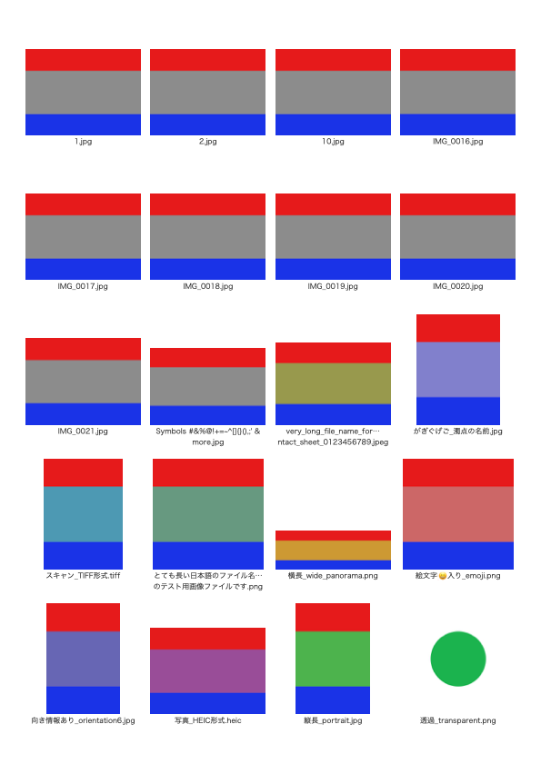

# 画像一覧PDF（contact-sheet-pdf）

複数の画像を「横○個 × 縦○個」に並べ、それぞれの画像の下に元のファイル名を添えたPDF（コンタクトシート）を作る macOS アプリです。写真や資料画像の一覧確認に使えます。

A small macOS app (Japanese UI) that lays out images in a grid with their original file names and saves the result as a PDF contact sheet.

画面は左から「画像一覧」「PDF プレビュー」「レイアウト設定と保存」の 3 列で、基本の操作は 1 つのウインドウで完結します。

## 特長

- Finder から画像をウインドウへドラッグ＆ドロップするだけで取り込めます（JPEG・PNG・HEIC・TIFF）。
- 横の個数・縦の個数、用紙（A4 縦／横）、余白、画像の間隔、ファイル名の文字サイズを指定できます。設定は次回起動時にも引き継がれます。
- 最初はファイル名順（1, 2, 10 の自然な順序）に並びます。一覧の行をドラッグして並べ替えられます。
- プレビューと保存する PDF は同じ描画処理で作るため、配置・改ページ・文字の表示が一致します。
- 長いファイル名は折り返し、それでも収まらない場合は拡張子を残して中間を「…」で省略します。
- PDF 内のファイル名は文字として書き込まれるので、検索・コピーできます。
- 画像は縦横比を保ったまま全体を表示します（切り抜き・変形なし）。写真の向き情報を反映し、透明な部分は白になります。
- 対応していない画像や壊れた画像は、ファイル名と理由を表示します。
- 処理はすべて Mac の中で完結します。通信・アカウント登録・クラウド接続はありません。

## ダウンロード

[Releases](https://github.com/moriyakeiichi/contact-sheet-pdf/releases/latest) から `contact-sheet-pdf-1.0.0-macos.zip` をダウンロードして展開し、`画像一覧PDF.app` を「アプリケーション」フォルダへ移動してください。

**はじめて開くとき**：Apple の Developer ID による署名・公証をしていないため、「開発元を確認できない」などと表示されて開けないことがあります。その場合は「システム設定」→「プライバシーとセキュリティ」を開き、下のほうにある「このまま開く」を押してください。

| 項目 | 内容 |
|---|---|
| macOS | macOS 13 Ventura 以降（動作を確認したのは macOS 26.7.1） |
| Mac | Apple シリコン・Intel 両対応のユニバーサル版（Intel 版は Apple シリコン上の Rosetta でのみ確認） |
| 追加のインストール | 不要 |

## 使い方

1. Finder から画像（またはフォルダ）をウインドウへドラッグ＆ドロップします。「画像を追加…」（⌘O）から選ぶこともできます。
2. 右側で「横の個数（列数）」と「縦の個数（行数）」を指定します（初期値は横 4 × 縦 5）。
3. 中央のプレビューで仕上がりを確認します。複数ページのときは「前のページ／次のページ」で切り替えます。
4. 「PDFを保存…」（⌘S）を押し、保存先とファイル名を指定します。

詳しくは [使い方.md](使い方.md) を見てください。

## 出力例

A4 縦・横 4 × 縦 5・余白 10 mm・間隔 4 mm・文字 8 pt で、テスト画像 21 枚を並べた 1 ページ目です（[PDF](動作確認/サンプルPDF/A4縦_横4x縦5_21枚.pdf)）。縦長・横長・透過・向き情報付きの画像、日本語・記号・絵文字を含む名前、省略される長い名前が混ざっています。



## ソースからビルドする

Xcode または Command Line Tools（`xcode-select --install`）があればビルドできます。外部ライブラリは使っていません。

```bash
git clone https://github.com/moriyakeiichi/contact-sheet-pdf.git
cd contact-sheet-pdf/ImageSheetPDF
./build.sh
```

リポジトリの直下に `画像一覧PDF.app` ができます。ソースの構成・設計・検証ツールについては [ImageSheetPDF/README.md](ImageSheetPDF/README.md) を見てください。

## 動作確認

[動作確認](動作確認) フォルダに結果をまとめています。

- [検証結果_PDF処理.txt](動作確認/検証結果_PDF処理.txt)：テスト画像を自動で作り、配置・文字・画素・保存の安全性・元画像が変わらないことなどを検証（73 項目、すべて合格）
- [検証結果_アプリ本体.txt](動作確認/検証結果_アプリ本体.txt)：アプリ本体でドロップの受け取り・並べ替え・保存・再起動後の設定の引き継ぎを検証（24 項目、Apple シリコンと Rosetta 上の Intel 版の両方で合格）
- [検証結果_実際の画面操作.txt](動作確認/検証結果_実際の画面操作.txt)：実際のマウス・キーボード操作による確認（Finder からのドラッグ＆ドロップ、行のドラッグ、delete キーなど）

macOS 標準の「画像を追加」パネル・保存パネルの中での操作と上書き確認ダイアログは、検証ツールから操作できないため未確認です。

## フォルダ構成

```
.
├── README.md           このファイル
├── 使い方.md            利用者向けの使い方
├── CHANGELOG.md        変更履歴
├── LICENSE             MIT ライセンス
├── ImageSheetPDF/      ソースコード（Swift Package・ビルドスクリプト）
├── 動作確認/            検証結果・サンプル PDF
└── docs/               この README で使う画像（出力例）
```

## ライセンス

[MIT License](LICENSE)
